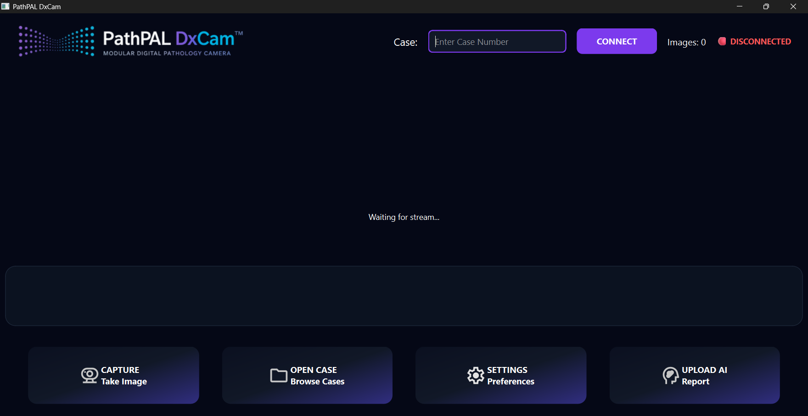
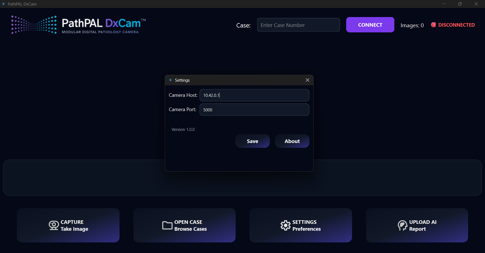
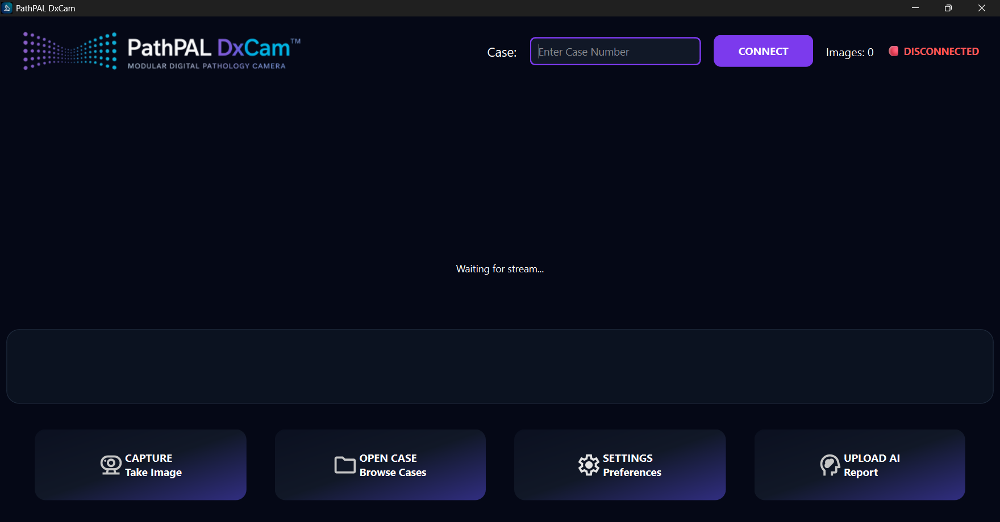
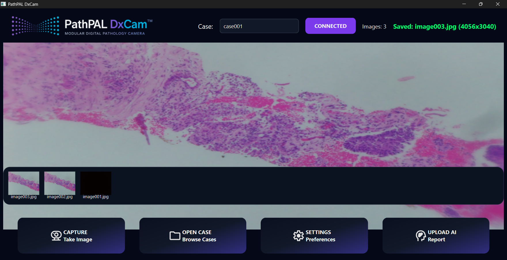
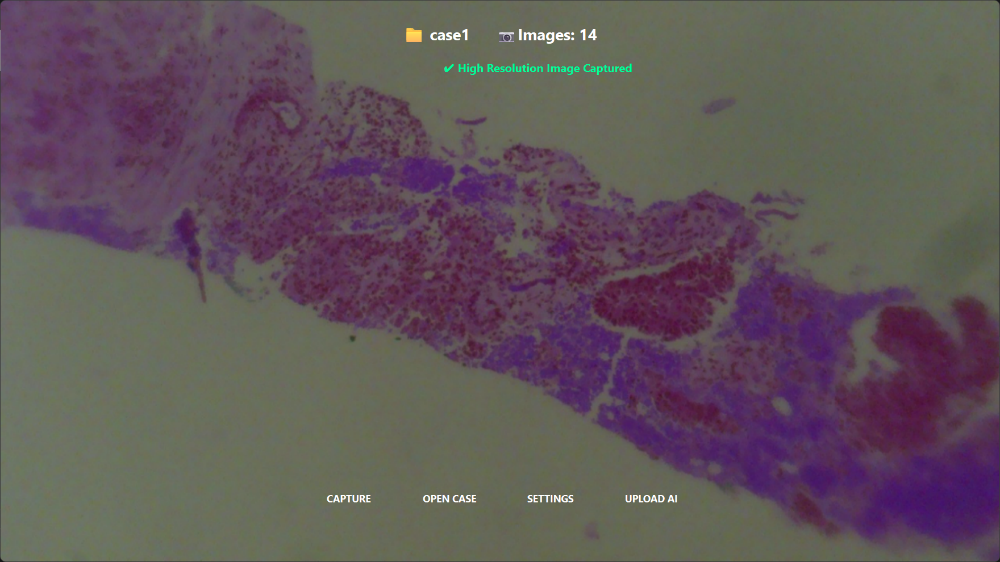
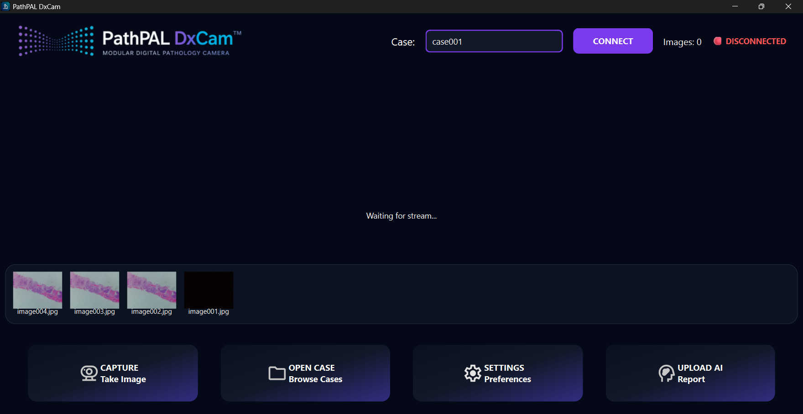
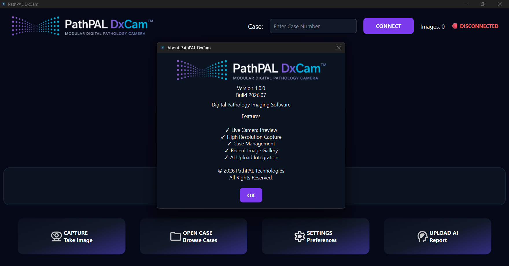

# 🔬 PathPAL DxCam
### Digital Microscopy Application

**A desktop-based digital microscopy solution for image acquisition, visualization, and case management.**

---

## 📌 Project Overview

**PathPAL DxCam** is a cross-platform digital microscopy desktop application developed to bridge traditional microscope viewing with digital image acquisition and management.

The application enables users to view live microscope images, capture high-resolution images, and organize captured images according to individual patient cases.

It is designed as part of a broader digital pathology ecosystem integrating microscope imaging, IoT-enabled camera hardware, and web-based application capabilities.

🌐 **Official Website:** https://www.pathpal.in/

The website represents the broader PathPAL platform, while the screenshots in this repository showcase the desktop application's interface and functionality.

---

## 🔗 System Concept: IoT Camera and Web Application

PathPAL DxCam is designed to work within an ecosystem connecting an IoT-enabled Raspberry Pi camera attached to a microscope with the PathPAL web application.

The intended workflow includes:

1. **Microscope Imaging:** A microscope is used to observe biological samples.
2. **Camera Integration:** An IoT-enabled Raspberry Pi camera captures the microscope's visual output.
3. **Application Connectivity:** The desktop application connects to the camera using configurable host and port settings.
4. **Live Visualization:** Users can view the live microscope feed through the application.
5. **Image Acquisition:** High-resolution images can be captured and organized into individual cases.
6. **Web Platform Direction:** The broader PathPAL ecosystem is intended to support digital record management and AI-assisted pathology workflows.

*Note: The production architecture and deployment of the broader ecosystem may evolve. This repository showcases the desktop application and does not claim that every planned integration is currently operational.*

---

## ✨ Key Features

- **Live Camera Preview:** View real-time microscope images through the application.
- **Camera Connection Settings:** Configure host and port details for camera connectivity.
- **Connection Status:** Monitor whether the camera is connected or disconnected.
- **High-Resolution Image Capture:** Capture microscope images for digital documentation.
- **Fullscreen Preview:** View microscope images in an expanded display mode.
- **Case-Based Organization:** Organize captured images according to individual patient cases.
- **Image Gallery:** Access and review previously captured images.
- **AI Workflow Entry Point:** Provides an interface direction for future AI-assisted analysis and reporting workflows.

---

## 🖥️ Application Screenshots

### 1. Main Application Interface

### 2. Camera Connection Settings

### 3. Disconnected Mode

### 4. Live Camera Preview

### 5. Fullscreen Image Preview

### 6. Gallery Strip

### 7. About Application

---

## 🛠️ Technology Stack

| Technology | Purpose |
|---|---|
| Python | Core application development |
| PySide6 | Desktop application interface |
| OpenCV | Camera integration and image processing |
| Raspberry Pi Camera | Microscope image acquisition hardware |
| PyInstaller | Application packaging and distribution |
| Windows & macOS | Cross-platform desktop support |

---

## 👩‍💻 Development Contributions

During my internship, I contributed to the development of PathPAL DxCam, focusing on:

- Designing and developing the desktop application's user interface.
- Implementing camera connection settings and connectivity handling.
- Integrating live camera preview functionality.
- Developing high-resolution image capture and fullscreen preview features.
- Implementing case-based image organization and gallery management.
- Working on application packaging and cross-platform compatibility for Windows and macOS.
- Contributing to the desktop application component of the broader IoT-enabled digital microscopy ecosystem.

---

## 📋 Project Information

| Category | Details |
|---|---|
| Project Name | PathPAL DxCam |
| Project Type | Internship Project |
| Application | Digital Microscopy Desktop Software |
| Hardware Integration | Raspberry Pi Camera |
| Platforms | Windows & macOS |
| Project Focus | Digital Imaging, Image Management, IoT Integration |

---

## 📁 Repository Scope

This repository is intended as a **project showcase and documentation repository**.

It contains application screenshots and a high-level overview of the project's features, technologies, and intended system workflow.

It does not distribute proprietary source code, executable binaries, internal configuration files, or confidential patient-related information.

---

## ⚖️ Intellectual Property Notice

PathPAL DxCam was developed during an internship at **PathAssist MedTech Pvt. Ltd.**

The project and its associated intellectual property belong to the company and/or their respective owners.

This repository is maintained solely for portfolio and demonstration purposes, subject to applicable company permissions. No ownership or license to the original software or intellectual property is claimed or granted through this repository.

---

**Project Showcase Only — No Source Code or Executable Is Distributed Here.**
**Developed as part of a Software Development Internship.**

